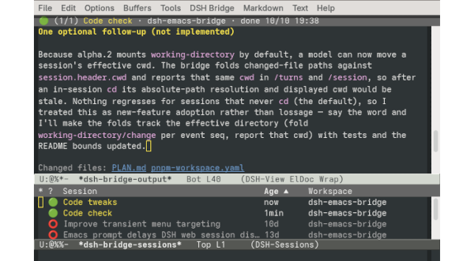

# dsh-emacs-bridge

This is a two-way bridge between
[GNU Emacs](https://www.gnu.org/software/emacs/) and the
[DeepSeek Harness](https://github.com/deepseek-ai/deepseek-harness)
(DSH).  It lets you control DSH from Emacs, including submitting
prompts, reading replies, and controlling sessions.  The Emacs-side
user interface is designed to closely follow Emacs conventions.



## Installation

The bridge consists of two components: a DeepSeek Harness plugin
(`dsh-emacs-bridge`), and an Emacs package to interact with the
harness (`dsh-bridge.el`).

### Requirements

- `dsh`, the [DeepSeek Harness](https://github.com/deepseek-ai/deepseek-harness).
- `pnpm` installed on the executable path (DSH uses it to install plugins).
- [GNU Emacs](https://www.gnu.org/software/emacs/), version 29 or later, installed on the executable path.
- (Recommended) The [Markdown mode](https://jblevins.org/projects/markdown-mode/) Emacs package.  From Emacs, install it via `M-x package-install RET markdown-mode RET`.

### Installing via the DSH Plugin Manager

1. From the DSH web interface, click **Plugins** in the left panel,
   then **Add Plugin** at the upper right.  Enter `dsh-emacs-bridge`
   into the box, and click **Install**.  When it finishes, click
   **Enable Now**.
   
   Or, from the command line,

   ```sh
   dsh plugin --profile web add dsh-emacs-bridge
   ```

2. If you are replacing a previous version of the plugin, restart DSH.
   (This is not needed for a first-time install.)

3. You should now see a `dsh-emacs-bridge` entry in DSH's Plugins
   page.  Click on it to open the configuration card, then click on
   the **Install Emacs package** button.  This installs the
   `dsh-bridge` library via the Emacs package manager.

4. Restart Emacs, or do `M-x package-initialize` in a running session.
   The [DSH Bridge commands](#Usage) will now be available in Emacs.

You can also install these same files manually: go to the [GitHub
release list](https://github.com/seewhydee/dsh-emacs-bridge/releases),
look for the file `dsh-emacs-bridge-<version>.tgz`, and get its URL.
Use this URL in the **Add Plugin** box, or in the command `dsh plugin
--profile web add <tarball-url>`.  Then download the accompanying
Emacs package `dsh-bridge-<version>.tar`, and install it with `M-x
package-install-file`.

### Manual installation from sources

You can also directly build and install the DSH plugin and Emacs
library from this repository.  First, go to this repository's root
directory and run the following to build the plugin:

```sh
make build
```

Next, install the plugin.  If you have `dsh` installed on the
executable path, run this:

```sh
# from this repo root:
dsh plugin --profile web add link:./dsh-plugin
dsh web
```

If instead you run DSH from a source checkout (`pnpm dsh web`), run
the following from the `deepseek-harness` directory, replacing the
`link:` path with the appropriate path into this repo:

```sh
# from deepseek-harness root:
pnpm dsh plugin --profile web add link:/absolute/path/to/dsh-emacs-bridge/dsh-plugin
```

Finally, install the Emacs library by putting this in your Emacs init
file, replacing the path with the actual path to `dsh-bridge.el`:

```elisp
(load "/path/to/dsh-emacs-bridge/emacs/dsh-bridge.el")
```

## Usage

From Emacs, the main entry-points are these two commands:

* `M-x dsh-bridge` — open a transient menu for DSH commands.
* `M-x dsh-bridge-list-sessions` — show a list of DSH sessions.

Consider giving either or both a global keybinding, e.g.,

```elisp
(keymap-global-set "C-c d" #'dsh-bridge)
```

### Transient menu

The `M-x dsh-bridge` command opens a transient menu that prompts for
the next command.  The menu's top line shows the session to be acted
on (chosen based on your recent activity); you can cycle through
available sessions with `M-p`/`M-n`.

Type `RET` to perform the default interaction on the session.  For
example, if the session is running, this command opens a view buffer
to show the replies; if the session is idle, it opens a prompt buffer
as well as a view buffer (if there are replies).

Here is a full list of commands are available from the transient menu:

* `q` — exit the transient menu.
* `M-p`/`M-n` — cycle through other sessions, ordered by age.
* `RET` — visit the session (e.g., open a prompt buffer and/or view
  buffer for it).
* `r` — open a buffer to type in a prompt.
* `f` — fetch and display the latest set of replies.
* `D` — describe the session.
* `t` — pin the current session as the target.
* `u` — unpin the currently-pinned session.
* `k` — stop the running session.
* `o` — compact the session's context history.
* `l` — open the DSH-Sessions buffer.
* `+` — create a new session and pin it.
* `p` — toggle plan mode.
* `G` — set or edit the goal objective (with `C-u`, also the round cap).
* `A` — pause an armed goal, or resume and rearm a stopped one.
* `X` — clear the current goal.

### DSH-Sessions buffer

The `M-x dsh-bridge-list-sessions` command opens a list of DSH
sessions.  The pinned target session (if any) is marked by a `*` in
the leftmost column, and the `S` (state) column shows each session's
live status.  The following commands are available from here:

* `q` — quit the window and bury the buffer.
* `RET` — visit the session at point (similar to `RET` in the
  transient menu).
* `r` — open a buffer to type a prompt for the session at point.
* `f` — fetch and display the output from the session at point.
* `a` — answer a pending user query for the session at point.
* `k` — stop the session at point if it is running.
* `o` — compact the context history of the session at point.
* `t` — pin the session at point as the target.  A cold session binds
        without being resumed; the host resumes it when a later request
        acts on it.
* `u` — unpin.
* `v` — toggle whether archived sessions are shown (hidden by default).
* `R` — rename the session at point.
* `d` — archive the session at point.
* `U` — unarchive the session at point.
* `+` — create a new session, in an existing or new workspace.
* `W` — rename the workspace of the session at point.
* `D` — describe the session at point.
* `g` — refresh the DSH-Sessions buffer.

For a full list, see the menu bar.  Other `tabulated-list-mode` keys
are also available.

### DSH-View buffer

This read-only buffer contains the model output for a DSH session.
Each buffer holds one agent turn (i.e., all replies from a user prompt
to an idle).  It is fetched by `f` from the transient menu or the
DSH-Sessions buffer, `C-c C-f` from the prompt buffer, or pushed from
the web UI's "Send to Emacs" button (see below).

The following commands are available in a DSH-View buffer:

* `g` — re-fetch the current session's newest turn.
* `r` — open a DSH-Prompt buffer for the current session.
* `B` — branch the shown turn into a new session.
* `k` — stop the shown session's running turn.
* `o` — compact the shown session's context history.
* `i` — receive the latest "Send to Emacs" turn (see below).
* `v` — show or hide the turn's tool calls and thinking summaries.
* `D` — describe the current session.
* `M-p`/`M-n` — cycle the current session's turns.
* `l` — open the DSH-Sessions buffer.
* `q` — quit the window and bury the buffer.

When created, a DSH-View buffer usually follows the latest turn,
automatically updated as more replies arrive.  Walking back through
older turns with `M-p` suspends following; cycling back to the newest
turn with `M-n` resumes it automatically.  To customize this behavior,
change `dsh-bridge-view-follow-at-newest`.

If Markdown mode is installed, and `dsh-bridge-view-gfm` is non-nil,
the replies are font-locked as GitHub-Flavored Markdown.

By default, a DSH-View buffer shows only the assistant's replies.
Type `v` (`dsh-bridge-view-toggle-activity`) to toggle viewing other
activity reports in the buffer, including tool calls and reasoning
block summaries.

#### Agent queries and approval requests

If the model requests additional user input via the
`ask_user_question` tool, the query is surfaced in the DSH-View
buffer.  Type `a` here (or in the DSH-Sessions buffer with point on
the session) to open a buffer for handling the query.  In the
resulting buffer, navigate to each question block and mark your
desired option with `RET` (or choose it with a number key), or type
`c` to enter a custom answer.  To submit the answers, type `C-c C-c`.
Alternatively, type `C-c C-k` to decline the query.

Special approval requests from the model (e.g., for sandbox
escalation) are also surfaced in the DSH-View buffer.  Upon receiving
such a request, type `a` to see the details in a help window; then you
can type `y` to accept the request once, `n` to reject it, or `c` to
cancel it.  Quitting (`C-g`) leaves the approval pending; type `a`
again to restart it.

If the web UI is open, the query or approval is shown there too.
Whichever answers first, Emacs or web UI, settles the request and
dismisses the other presentation.  To change this (e.g., letting the
web UI handle all requests), customize `dsh-bridge-approval-answer`.

### DSH-Prompt buffer

The DSH-Prompt buffer is used to compose a prompt, or reply.  It is
opened by `r` from the transient menu, DSH-View buffer, or the
DSH-Sessions buffer.  You can also open it with `RET` from the
DSH-Sessions, if the session is waiting for a prompt.

The target session is determined by how the buffer was invoked; for
instance, `r` from a DSH-View buffer opens a prompt for the same
session.

The following commands are available from the DSH-Prompt buffer:

* `C-c C-c` — send the prompt, and pop to a DSH-View buffer to see the reply.
* `C-c C-a` — attach a file to the prompt (see below).
* `C-c C-m` — set the model and reasoning effort.
* `C-c C-s` — rebind the buffer to another session.
* `C-c C-k` — stop the session if it is running, or erase the prompt otherwise.
* `C-c C-o` — compact the session's context history.
* `C-c C-f` — open the DSH-View buffer for this session.
* `C-c C-l` — open the DSH-Sessions buffer.
* `M-p`/`M-n` — walk the session's prompt history.

When Markdown mode is installed, this buffer derives from it, so most
markdown editing commands are also available.

If the session is running when you invoke `C-c C-c`, the command asks
how exactly to send the prompt; you queue it to run after the current
turn, steer the running turn, or cancel.  Customize
`dsh-bridge-send-while-running` to change this behavior.  To
unconditionally steer, type `C-u C-c C-c`.

While walking the prompt history with `M-p`/`M-n`, you may edit
earlier prompts.  This blocks further history navigation; to resume,
you must send the prompt first, or revert with `M-x revert-buffer`.

#### Attachments

From the DSH-Prompt buffer, type `C-c C-a` to attache a file to send
along with the prompt.  This prompts for a file in the minibuffer, and
inserts a tag line into the prompt buffer:
```
<#attachment filename="/home/you/screenshot.png">
```
If you change your mind and no longer want to attach the file, just
delete the tag line before sending.

From elsewhere in Emacs, you can also run `M-x dsh-bridge-attach-file`
directly to open a DSH-Prompt buffer with the specified attachment, or
`M-x dsh-bridge-attach-buffer-file` to open a prompt with the current
buffer's file as the attachment.

### Plan mode and goals

You can toggle plan mode, or set a session goal, with these commands:

* `M-x dsh-bridge-toggle-plan-mode` — toggle plan mode.  With a
  numeric prefix argument, enable it if positive, disable otherwise.
* `M-x dsh-bridge-set-goal` — set or edit the goal objective.
  With a prefix argument, also read the goal round cap.
* `M-x dsh-bridge-toggle-goal` — pause or resume goal.
* `M-x dsh-bridge-pause-goal` — pause an active goal.
* `M-x dsh-bridge-resume-goal` — resume a paused or blocked goal.
* `M-x dsh-bridge-clear-goal` — clear the current goal.

These commands are also available in the menu bar.

### Sending replies from DSH to Emacs

The DSH plugin adds a "Send to Emacs" button to the DSH web interface,
which lets you push assistant replies to Emacs.  A pushed turn
automatically pops up in a DSH-View buffer in Emacs.  You can also
visit the latest pushed turn using `i` in the DSH-View buffer, or run
`M-x dsh-bridge-receive`.

## Security Matters

The DSH-Emacs bridge listens on the DSH web server's loopback
interface.  It never contacts a third-party service.  Every route is
gated by a shared bearer token, generated on first use and stored with
owner-only permissions at `~/.dsh/dsh-bridge-token`.  Emacs reads that
file directly, and the plugin fetches it from a route fenced to
loopback peers and same-origin pages.  Any third party with access to
the token can do everything this Emacs package can (send prompts, read
session logs, answer queries and approval requests, etc.).

Request bodies are capped at 1 MiB, and messages waiting for Emacs sit
in a bounded outbox.  The turn activity reporter, `/turns`, carries at
most 500 of the latest activity entries per turn, and activity for at
most the newest 40 turns.  At present, reasoning activity is only
shown as one-line summaries; the full text stays in DSH.

The *Install Emacs package* button in the plugin configuration card is
the one place that spawns a process.  Clicking it runs `emacs` in
batch mode, with fixed arguments, to install the bundled
`dsh-bridge.el` into the [Emacs packaging system](https://www.gnu.org/software/emacs/manual/html_node/emacs/Packages.html).

## License

This software is released under the terms of the GNU General Public
License version 3, or later.  See [COPYING](COPYING).
